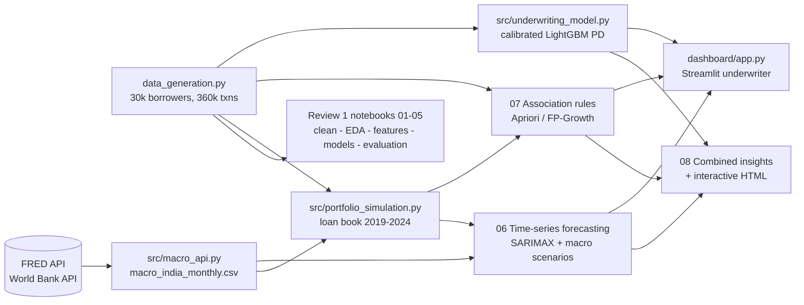

# IntelliCredit: FinTech Micro-Lending Risk & Alternative Credit Scoring Engine

> **Capstone Project — Business Analytics (Review 1 + Review 2)**
> Private Review 2 repository. Review 1 lives in the team repo [Darun1017/credit-scoring-engine](https://github.com/Darun1017/credit-scoring-engine).
> An end-to-end risk analytics engine for thin-file and gig-economy borrowers: programmatic transaction data, **live macroeconomic APIs**, interpretable default prediction, association-rule warning patterns, portfolio default forecasting, and an interactive loan-underwriter dashboard.

---

## Problem Statement

1.4 billion adults worldwide are unbanked (World Bank Global Findex 2021), and India's 7.7–12 million gig and platform workers (NITI Aayog 2022; Economic Survey 2025-26) mostly have thin or no credit files (CIBIL/FICO). Lenders either exclude them unfairly or lend blind and suffer high defaults. Traditional scoring ignores alternative behavioural signals, is hard to explain, and ignores macroeconomic shocks.

**IntelliCredit** answers four questions:

| Question | Method | Where |
|---|---|---|
| **Who** is likely to default? | Interpretable ML (LR, RF, XGBoost, LightGBM, ensembles) + SHAP | `notebooks/01`–`05` (Review 1) |
| **Which combinations** of behaviours signal delinquency? | Association rule mining (Apriori / FP-Growth) | `notebooks/07` (Review 2 · Method 2) |
| **When** will portfolio defaults rise, and by how much? | Time-series forecasting (SARIMAX with macro drivers) + stress scenarios | `notebooks/06` (Review 2 · Method 1) |
| **What should the underwriter do now?** | Real-time decision dashboard combining all three | `dashboard/app.py`, `notebooks/08` |

---

## Rubric Coverage

### Review 1 — Data Analysis & Predictive Modelling (20 marks)
| Component | Marks | Delivered in |
|---|---|---|
| Problem statement, business objective & dataset description | 2 | `01_M1` Part A, this README, `data/data_dictionary.txt` |
| Data cleaning & preprocessing | 3 | `01_M1` — missing values (KNN / mode), IQR outliers, winsorisation, ordinal + one-hot encoding |
| Exploratory data analysis & visualisation | 3 | `02_M2` — 38 charts, chi-square & Mann-Whitney tests |
| Feature engineering / dimensionality reduction | 2 | `03_M3` — 14 engineered features, VIF, MI + RFE, **WoE / IV**, PCA, t-SNE, SMOTE (train only) |
| Predictive model development | 4 | `04_M4` — 5 baselines, tuned LR/RF/XGB/LGBM, voting & stacking, leak-free CV |
| Model evaluation & result interpretation | 3 | `05_M5` — ROC/PR, KS, lift/gains, calibration, SHAP, INR cost-optimal threshold |
| Presentation & individual contribution | 3 | [Individual Contributions](#individual-contributions) |

### Review 2 — Advanced Analytics (20 marks)
| Component | Marks | Delivered in |
|---|:---:|---|
| Method 1 (Time-Series): data preparation & implementation | **2** | `06_R2_M1` Parts A–C, `src/macro_api.py`, `src/portfolio_simulation.py` |
| Method 1: evaluation & interpretation | **3** | `06_R2_M1` Parts D–G, `models/ts_model_comparison.csv`, `models/ts_backtest_summary.csv` |
| Method 2 (Association Rules): data preparation & implementation | **2** | `07_R2_M2` Parts A–B, `models/arm_model_comparison.csv` |
| Method 2: evaluation & interpretation | **3** | `07_R2_M2` Parts C–F, `models/association_rules.csv` |
| Combined business insights & recommendations | **2** | `08_R2` Section 5, `reports/Review_2_Final_Report.md` |
| Interactive dashboard or website (Mandatory) | **5** | `dashboard/app.py` (Streamlit 5-tab engine + Dataset Explorer) + `reports/interactive_dashboard.html` |
| Presentation & individual contribution | **3** | [Individual Contributions](#individual-contributions), `reports/project_management_and_contributions.md`, `reports/Review_2_Presentation_Slides.md` |
| **Total** | **20** | |

---

## Data Collection (rubric: "data source and collection method must be documented")

No pre-built Kaggle / UCI / GitHub dataset is used.
> **Review 1 feedback — "use real data":** borrower files are legally unavailable (CICRA 2005, DPDP Act 2023), so we collected **five real credit datasets from official APIs** (IMF, World Bank, FRED, CFPB HMDA, CFPB complaints — 69,662 records) and re-ran both Unit 3 methods on them in `notebooks/09_R3_real_data_validation.ipynb`. See [Real-data validation](#real-data-validation-track) and `data/DATASET_VALIDATION_SUMMARY.md` §7.

| Dataset | Rows | Source | Collected by |
|---|---|---|---|
| `data/borrower_profiles.csv` | 30,000 | **Synthetic** — NumPy distributions + Faker (en_IN), correlated behaviour, logistic default label | `data_generation.py` |
| `data/monthly_transactions.csv` | 360,000 | **Synthetic** — 12 months of income, utility, recharge, BNPL, UPI per borrower | `data_generation.py` |
| `data/macroeconomic_indicators.csv` | 36 | **Synthetic** macro series (used by the Review 1 EDA; kept as the offline fallback) | `data_generation.py` |
| `data/external/macro_india_monthly.csv` | 108 months | **Live APIs** — see below | `src/macro_api.py` |
| `data/portfolio/*.csv` | 30,000 loans / 250k loan-months / 72 months | **Simulation** of the same 30,000 borrowers' repayment, driven by the real macro data | `src/portfolio_simulation.py` |

### Live macroeconomic APIs
| Indicator | API | Series | Frequency |
|---|---|---|---|
| CPI inflation (YoY %) | **FRED** | `CPALTT01INM659N` | monthly |
| Call-money (interbank) rate | **FRED** | `IRSTCI01INM156N` | monthly |
| 10-year G-sec yield | **FRED** | `INDIRLTLT01STM` | monthly |
| INR per USD | **FRED** | `EXINUS` | monthly |
| Unemployment rate | **World Bank** | `SL.UEM.TOTL.ZS` | annual → monthly (interpolated) |
| Real GDP growth | **World Bank** | `NY.GDP.MKTP.KD.ZG` | annual → monthly |
| Lending rate | **World Bank** | `FR.INR.LEND` | annual → monthly |

Neither API needs a key. Each raw response is cached in `data/external/raw/`, and provenance is recorded per column in `data/external/macro_sources.json`: endpoint, series ID, whether it came live, and the last observation. **Fallback order:** live API → cached raw file → synthetic series, so the pipeline never breaks offline. COVID lockdown and second-wave months are added as event dummies taken from the public record.

---

## Real-Data Validation Track

**Review 1 panel comment: "why synthetic data — use real data."** Borrower-level credit files in India are confidential
(Credit Information Companies (Regulation) Act 2005, DPDP Act 2023), and the rubric forbids Kaggle/UCI copies. So we
collected **every real credit-risk dataset that is legally open**, from official APIs, and re-ran both Unit 3 methods on it.

| Real dataset | API (no key) | Rows | Used for |
|---|---|---:|---|
| India banks' NPL ratio, quarterly 2010-Q1 → 2026-Q2 | **IMF** Financial Soundness Indicators | 63 | Method 1 on real Indian defaults |
| NPL ratio + GDP, unemployment, inflation, lending rate | **World Bank** WDI | 5,642 | 140-country check of the macro → default mechanism |
| US consumer-loan delinquency + macro, 1987 → 2026 | **FRED** | 158 | conformal prediction intervals |
| Loan-level applications with the lender's decision (2023) | **CFPB HMDA** Data Browser | 48,799 | Method 2 on real loans, fairness |
| Payday / personal-loan complaints | **CFPB** Complaint Database | 15,000 | borrower pain points |

```bash
python -m src.real_data            # collect (cached in data/real/raw, provenance in data/real/real_sources.json)
jupyter nbconvert --to notebook --execute --inplace notebooks/09_R3_real_data_validation.ipynb
```

| Result on real data | Number |
|---|---|
| India NPL ratio, 14 unseen quarters: SARIMAX + RBI regime ramps (BIC choice) | **MAE 0.48 pp** (ETS 0.91, ARIMA 1.03, naive 2.04) |
| Adaptive conformal 80% band, 94 rolling US forecasts | **81% coverage** (Gaussian model band: 72%) |
| 140-country panel: Δunemployment / GDP growth / inflation → ΔNPL | +0.28 / −0.11 / +0.08, all p < 0.05 — same signs as our simulation |
| HMDA denial rules mined on DE + RI, checked on Vermont | 82 rules, **95% keep lift ≥ 1.3**, rule-count AUC 0.707 |
| Where synthetic data was wrong | no COVID forbearance (real NPLs fell in 2020); debt burden under-weighted (real DTI≥50% lift 2.55 vs synthetic 1.12) |

## Innovations

1. **Conformal prediction for credit forecasts** — distribution-free intervals; Adaptive Conformal Inference (Gibbs & Candès 2021) keeps coverage through COVID where model intervals fail (notebook 09 Part B).
2. **Regime-aware NPL forecasting for India** — RBI's Asset Quality Review, IBC clean-up and COVID standstill enter as regime ramps; they explain India's real NPL path better than macro drivers alone.
3. **Counterfactual "path to approval"** in the dashboard — the cheapest *actionable* changes that turn a decline into an approval (`src/recourse.py`; Wachter 2017, Ustun 2019, DiCE 2020). The interest rate and immutable attributes are never used.
4. **Synthetic-vs-real fidelity scorecard** — every mechanism the synthetic data relies on is tested on real data, and failures are reported (notebook 09 Part F, dashboard tab *Real-Data Reality Check*).
5. **Fairness audit on real lending decisions** — adjusted denial odds by race and sex after the risk flags (HMDA).

Research evidence (72 verified sources, 29 open-access PDFs, benchmark tables, reviewer answers): [`research/`](research/).

---

## Architecture



---

## Repository Structure

```text
credit-scoring-engine/
├── README.md
├── requirements.txt
├── data_generation.py                  # synthetic borrowers + transactions (Review 1 data)
├── src/
│   ├── config.py                       # shared paths, ordinal maps, seeds
│   ├── macro_api.py                    # FRED + World Bank collector (cached, with fallback)
│   ├── portfolio_simulation.py         # macro-driven monthly loan-performance panel
│   ├── underwriting_model.py           # calibrated PD model + break-even decision rule
│   ├── risk_rules.py                   # applies mined warning rules to applicants
│   ├── real_data.py                    # IMF, World Bank, FRED, HMDA, CFPB collectors (cached, provenance)
│   └── recourse.py                     # counterfactual path-to-approval
├── data/
│   ├── borrower_profiles.csv · monthly_transactions.csv · macroeconomic_indicators.csv · data_dictionary.txt
│   ├── processed/                      # outputs of M1 & M3 (cleaned data, train/test, SMOTE)
│   ├── external/                       # API data, raw API responses, provenance
│   └── portfolio/                      # loan_book, loan_performance, portfolio_monthly
├── notebooks/
│   ├── 01_M1_data_cleaning_preprocessing.ipynb
│   ├── 02_M2_exploratory_data_analysis.ipynb
│   ├── 03_M3_feature_engineering.ipynb
│   ├── 04_M4_predictive_modeling.ipynb
│   ├── 05_M5_evaluation_interpretation.ipynb
│   ├── 06_R2_M1_time_series_forecasting.ipynb      # Review 2 · Method 1
│   ├── 07_R2_M2_association_rule_mining.ipynb      # Review 2 · Method 2
│   ├── 08_R2_combined_insights_dashboard.ipynb     # combined insights + Plotly visuals
│   └── 09_R3_real_data_validation.ipynb            # REAL data: IMF/World Bank/FRED/HMDA/CFPB + conformal
├── dashboard/app.py                    # Streamlit loan-underwriter dashboard
├── models/                             # model comparison, forecasts, rules, dashboard model
├── reports/                            # interactive_dashboard.html, dashboard screenshots
└── scripts/
    ├── Review_1_Data_Analysis_and_Predictive_Modeling.ipynb   # condensed Review 1 notebook
    └── generators/                     # scripts that build the notebooks
```

---

## How to Run

```bash
git clone https://github.com/Goldmauler/intellicredit-review2.git   # private Review 2 repo
cd intellicredit-review2
python -m venv venv && venv\Scripts\activate        # macOS/Linux: source venv/bin/activate
pip install -r requirements.txt

# 1. Data
python data_generation.py                 # synthetic borrowers & transactions
python -m src.macro_api                   # live FRED + World Bank data (add --offline to use the cache)
python -m src.portfolio_simulation        # macro-driven loan book
python -m src.underwriting_model          # calibrated PD model for the dashboard

# 2. Notebooks, in order: 01 -> 08 (each reads the previous outputs)
jupyter lab

# 3. Dashboard
streamlit run dashboard/app.py
```
All randomness is seeded (`42` for data and models, `2026` for the loan-book simulation), so re-running reproduces every number below.

---

## Results

### Review 1 — default prediction (test set, 6,000 borrowers)
| Model | AUC-ROC | PR-AUC | Recall @0.5 | F1 @0.5 |
|---|---|---|---|---|
| **XGBoost (tuned)** | **0.738** | **0.204** | 0.682 | 0.247 |
| LightGBM (tuned) | 0.735 | 0.201 | 0.614 | **0.256** |
| Logistic Regression (tuned) | 0.728 | 0.197 | 0.638 | 0.241 |
| Random Forest (tuned) | 0.713 | 0.178 | 0.663 | 0.226 |
| Calibrated LightGBM (dashboard) | 0.741 | 0.199 | — | — |
| *True default probability (ceiling)* | *0.781* | *0.262* | | |

* KS = 0.36. The top decile defaults at 23% (2.9× lift), and the riskiest 30% of applicants contain 63% of all defaults.
* XGBoost captures about **85% of the achievable discrimination**. The labels are random draws from a known PD, so no model can exceed AUC 0.781.
* At the cost-optimal threshold (a missed default costs ≈ ₹81.9k; a wrong rejection ≈ ₹9.7k of lost interest), **74.7% are approved, with a 4.4% default rate**, versus 7.9% if everyone were approved.
* Top drivers (SHAP): gig tenure, income trend, on-time utility payments, loan size, income volatility.

### Review 2 · Method 1 — portfolio default-rate forecasting
| Model | 2024 hold-out MAE (pp) | MAPE | Backtest mean MAE (40 origins) |
|---|---|---|---|
| **SARIMAX + macro drivers** | **0.054** | **16%** | **0.124** |
| Gradient boosting (lags + macro) | 0.065 | 22% | — |
| Holt-Winters (ETS) | 0.075 | 24% | 0.208 |
| SARIMA | 0.088 | 30% | 0.176 |
| Seasonal naive | 0.124 | 40% | 0.351 |

* Every macro driver is significant with the expected sign: unemployment +1 pp → **+21%** defaults; CPI +1 pp → +15%; call-money rate +1 pp → +10%; lockdown month ×5.7.
* Residuals are white noise (Ljung-Box p = 0.12 / 0.28), and the 80% interval covers 92% of 2024 actuals.

| 2025 scenario | Avg monthly default rate | Expected credit loss | vs baseline |
|---|---|---|---|
| Baseline | 0.28% | ₹1.59 crore | — |
| Adverse (unemployment +1.5 pp, GDP −3 pp) | 0.33% | ₹1.95 crore | +₹36 lakh |
| Severe (COVID-style) | 0.74% (peak 2.7%) | ₹4.32 crore | +₹2.74 crore |

### Review 2 · Method 2 — delinquency warning rules
* 19 behavioural flags on 24,000 training borrowers give 2,852 frequent itemsets. After filtering (lift ≥ 1.5, support ≥ 0.5%, Bonferroni-corrected Fisher p < 0.05) and redundancy pruning, **93 rules** remain.
* **All 93 hold on unseen borrowers** (test lift ≥ 1.3).
* Top rule: *declining income + volatile income + low savings buffer → 24.7% default rate (3.1× lift on test)*.
* Applicants triggering 6+ rules default at 24.7%, versus 4.9% with none. Routing applicants with ≥ 3 rules to manual review flags 14% of them and catches 34% of all defaults.
* Under macro stress, *volatile income* adds +4.5 extra default points, while *low income* and *rural location* add nothing extra.

### Combined
* Within the same lowest-risk PD band, applicants with 6+ triggered rules default **3× more** (5.6% vs 1.8%). Rules add information the PD alone misses.
* Point-in-time PD = PD × forecast multiplier. Under the same break-even rule, approvals move from **75%** (benign 2025 baseline) to **48%** (severe).

### Dashboard
| Underwriter | Portfolio outlook |
|---|---|
|  |  |

---

## Audit Fixes Applied to Review 1 (October 2026)

| Issue found | Impact | Fix |
|---|---|---|
| `month_label` built with `timedelta(30 * i)` | repeated months (two "2025-01" rows per borrower) | `pd.date_range(..., freq="MS")`; numeric data unchanged |
| M1 ordinal maps used labels not in the data (`High School`, `Urban`, …) | most rows encoded as −1 | use `src/config.ORDINAL_MAPS`, assert every category maps |
| M3 `platform_risk_premium` / `macro_stress_exposure` were target means over **all** rows | test labels leaked into features | split fixed first; smoothed target encoding on train only; platform dropped (χ² p = 0.71) |
| M3 RFE fitted on one random sample's X with **another** sample's y | RFE selection was noise | single fixed train sample |
| M3 MI / RFE fitted on all rows; constant `total_utility_bills` selected | selection leakage, useless feature | train-only selection, zero-variance filter, added WoE/IV screen (README previously claimed WoE/IV without implementing it) |
| M4 CV and tuning on pre-SMOTEd data | RF CV AUC 0.98 vs 0.69 on test | SMOTE inside an `imblearn` pipeline; RF CV now 0.72, consistent with test |
| M5 looked for `test_data.csv` / `*.pkl` | silently re-trained **different, untuned** models | loads M3's `test.csv` and M4's `tuned_*.joblib` |
| Hard-coded `c:/Users/rgdar/...` path; qualitative "Very High" tables; `$` costs | notebook would not run elsewhere; claims contradicted results | relative paths, computed tables, INR costs from the portfolio |
| LightGBM 4.7.0 crashes on Windows | M4 hung | pinned `lightgbm<4.7` |

---

## Individual Contributions & Project Governance

* **Project Board (Kanban & Sprint Tracking):** [GitHub Project Board — @Darun1017\'s credit-scoring-engine](https://github.com/Darun1017/credit-scoring-engine/issues?q=is%3Aissue) (19 Tasks: 10 Review 1 + 9 Review 2)
* **Detailed Task History & Workload Evidence:** See [reports/project_management_and_contributions.md](reports/project_management_and_contributions.md)
* **Final Comprehensive Technical Report:** See [reports/Review_2_Final_Report.md](reports/Review_2_Final_Report.md)
* **15-Minute Panel Presentation Slides Deck:** See [reports/Review_2_Presentation_Slides.md](reports/Review_2_Presentation_Slides.md)
* **Dataset Description & Validation Summary:** See [data/DATASET_VALIDATION_SUMMARY.md](data/DATASET_VALIDATION_SUMMARY.md)

| Member | GitHub Username | Assigned Tasks | Assigned Role & Contribution | Rubric Component (Marks) | Main Deliverable Files |
|---|---|:---:|---|---|---|
| **Darun R G** | @Darun11 / @Darun1017 | Tasks #2, #3, #6, #13, #18 (+ #1, #9, #10, #19) | Data architecture, synthetic generator, feature engineering, ARM data prep, dataset validation summary & real-world benchmarks | Overall Dataset Description & Validation, Baseline ML Pipeline (Unit 1 & 2) | data_generation.py, notebooks/01-05, data/DATASET_VALIDATION_SUMMARY.md |
| **goldmauler** | @Goldmauler | Tasks #7, #11, #12, #13, #14, #15 (+ #1, #9, #10, #19) | **Lead — Method 1 (Time-Series) & Method 2 (ARM)**: Stationarity, STL, Granger, SARIMAX with live APIs, Apriori vs FP-Growth, 93 warning rules, combined insights | **Method 1 (5 marks) + Method 2 (5 marks)** | notebooks/06_R2_M1, notebooks/07_R2_M2, src/macro_api.py, models/arm_model_comparison.csv |
| **Abhinav Juturu** | @abhinav-juturu | Tasks #5, #11 (+ #1, #9, #10, #19) | **Portfolio Risk Modeler & EDA**: 38 exploratory charts, hypothesis testing, loan book simulation, macro-linked DPD migration | Method 1 Data Prep, EDA & Scenario Loss (2 marks) | src/portfolio_simulation.py, notebooks/02_M2, data/portfolio/ |
| **Gowtham Reddy** | @gowthamreddy285 | Tasks #4, #16, #17 (+ #1, #9, #10, #19) | **Interactive Dashboard & Full-Stack UI**: Data cleaning/preprocessing, production Streamlit 5-tab application, TreeSHAP waterfall charts, HTML report | **Mandatory Interactive Application (5 marks)** | dashboard/app.py, notebooks/01_M1, reports/interactive_dashboard.html |
| **Adithya** | @adii11001 | Tasks #8, #15, #17, #19 (+ #1, #9, #10, #19) | **Business Intelligence & Technical Reporter**: Model evaluation, TreeSHAP explainability, combined insights synthesis, technical report & panel slides | **Combined Business Insights (2 marks) + Presentation Defense (3 marks)** | notebooks/05_M5, notebooks/08_R2, reports/Review_2_Final_Report.md, reports/Review_2_Presentation_Slides.md |

Each member presents their designated technical module during the 15-minute panel defense (Presentation & Individual Contribution: 3 marks).

---

## Limitations

* Borrowers, transactions and the loan book are **synthetic**, which the rubric allows. We compared them with verified real-world anchors where sources exist, and Section 7 of [`data/DATASET_VALIDATION_SUMMARY.md`](data/DATASET_VALIDATION_SUMMARY.md) states where the synthetic data does **not** match (fewer low earners than the Economic Survey reports, and a COVID default spike that real bank NPLs did not show). Only the macro indicators are live from institutional APIs.
* World Bank indicators are annual, interpolated to monthly. CPI on FRED ends in March 2025 and is carried forward, flagged in the data.
* The loan book's defaults come from a macro-linked hazard (a CreditPortfolioView-style logit link). The forecaster recovering that link validates the pipeline; it is not evidence about real Indian borrowers.
* The SMOTE / class-weighted Review 1 models rank well but over-state PD (mean ≈ 40% vs 7.9% observed). The dashboard therefore uses a separately calibrated model.
