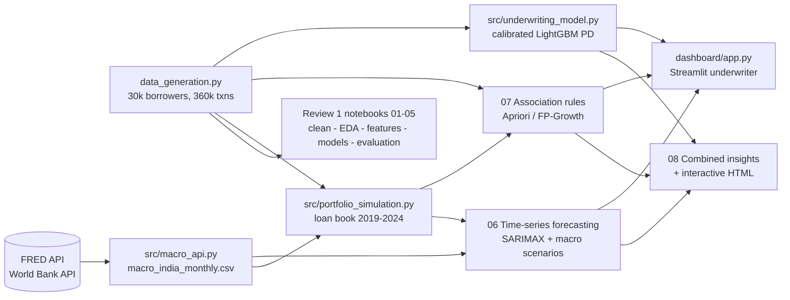
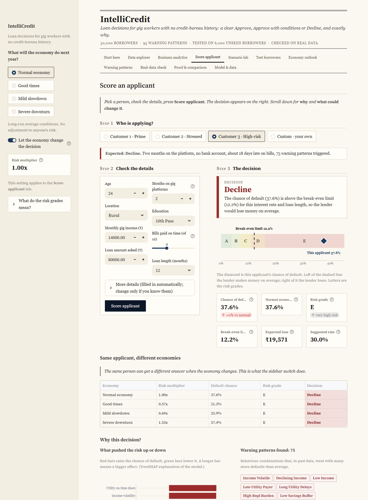
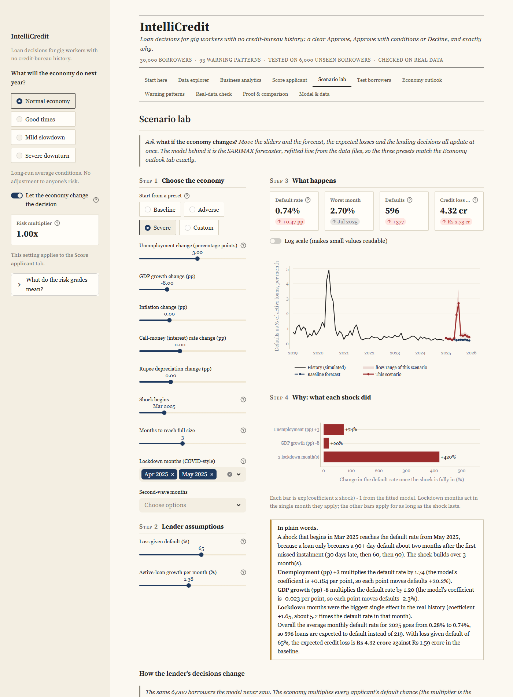
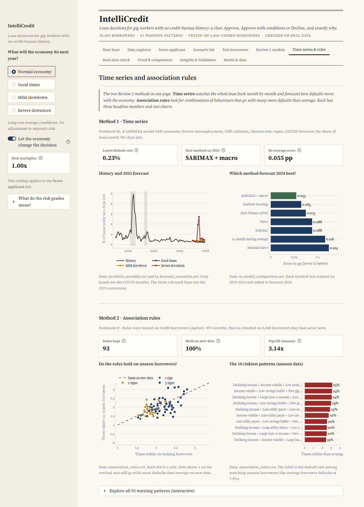
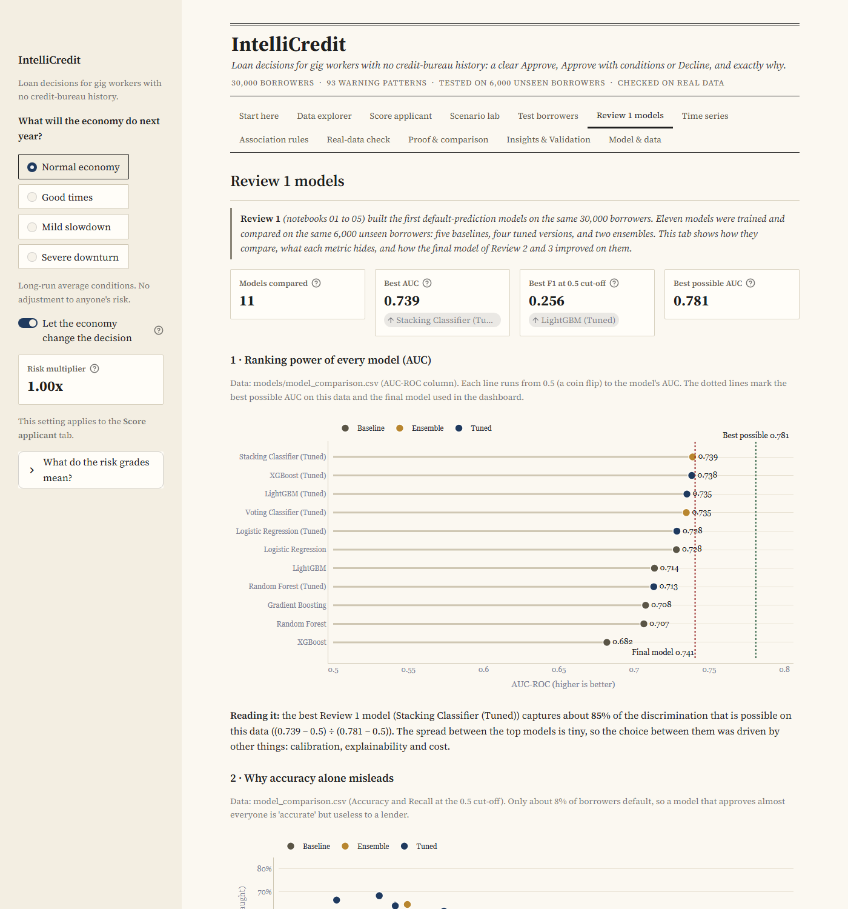
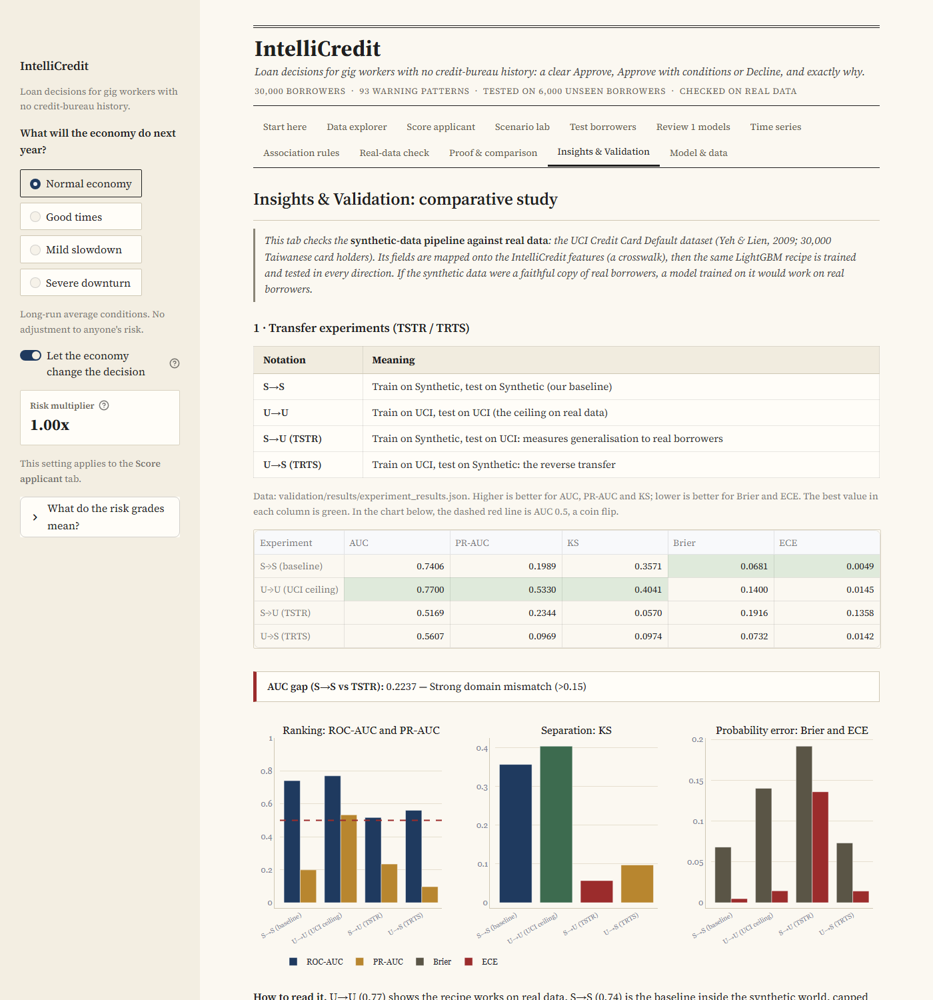
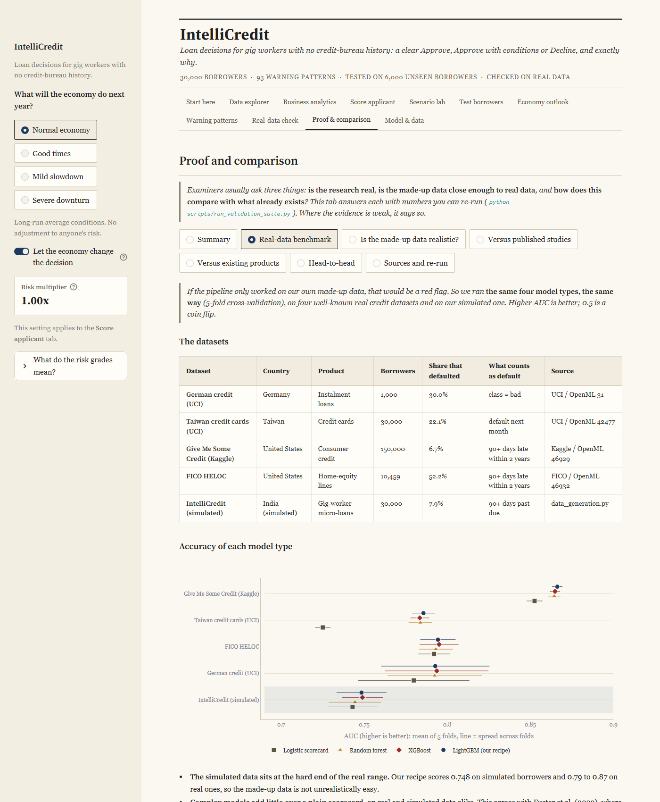
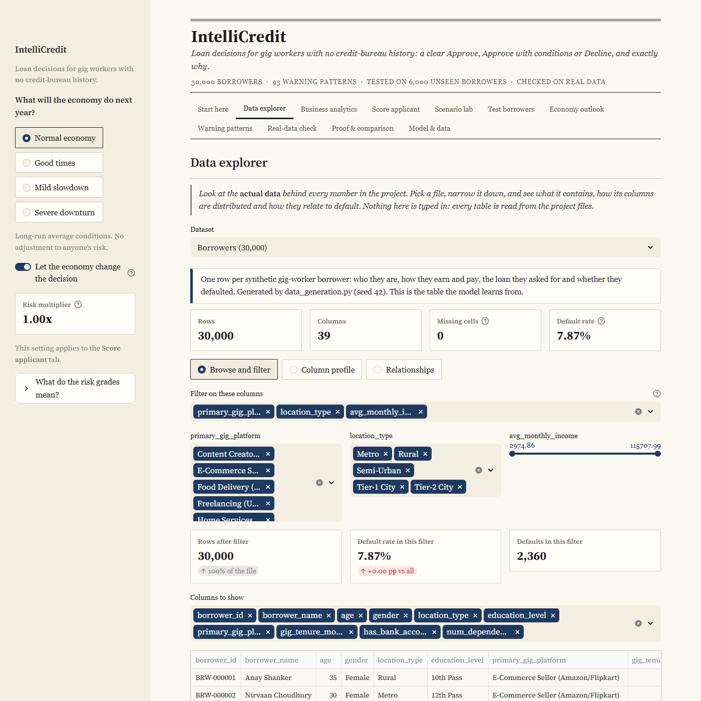

# IntelliCredit: FinTech Micro-Lending Risk & Alternative Credit Scoring Engine

> **Capstone Project — Business Analytics (Review 1, Review 2 and Review 3)**
> Private repository for Reviews 2 and 3. Review 1 lives in the team repo [Darun1017/credit-scoring-engine](https://github.com/Darun1017/credit-scoring-engine).
> An end-to-end risk analytics engine for thin-file and gig-economy borrowers: programmatic transaction data, **live macroeconomic APIs**, interpretable default prediction, association-rule warning patterns, portfolio default forecasting, and an interactive loan-underwriter dashboard.

---

## Problem Statement

1.4 billion adults worldwide are unbanked (World Bank Global Findex 2021), and India's 7.7–12 million gig and platform workers (NITI Aayog 2022; Economic Survey 2025-26) mostly have thin or no credit files (CIBIL/FICO). Lenders either exclude them unfairly or lend blind and suffer high defaults. Traditional scoring ignores alternative behavioural signals, is hard to explain, and ignores macroeconomic shocks.

**Why this matters now** (checked 10 Nov 2026):
- **29 Jan 2026, Economic Survey 2025-26:** about 12 million gig workers in FY25, up 55% from 7.7 million in FY21 and over 2% of the workforce; about 40% of them earn under ₹15,000 a month ([Business Today](https://www.businesstoday.in/amp/union-budget/story/india-has-12-million-gig-workers-2-of-total-workforce-economic-survey-513429-2026-01-29)).
- **28 Feb 2026, MFIN (microfinance lenders' body):** its CEO said the sector is "past the peak" of its recent stress, with loans 1-180 days overdue at 4.7% in January and liquidity still tight ([Business Today](https://www.businesstoday.in/latest/economy/story/indias-microfinance-sector-past-stress-peak-portfolio-quality-improves-mfin-518542-2026-02-28)). Low-income delinquency can swing within a year, which is what the scenario forecasts in Method 1 are for.
- **30 Oct 2026, Ministry of Labour:** notified the National Social Security Board for unorganised, gig and platform workers ([Siasat](https://www.siasat.com/govt-notifies-national-social-security-board-for-gig-platform-workers-3566984/)).
- **3 Nov 2026, UPI:** a record 25.47 billion transactions worth ₹31.53 lakh crore in October ([Entrepreneur India](https://india.entrepreneur.com/business-news/upi-hits-record-25-47-bn-transactions-in-october-daily-value-crosses-inr-1-l-cr)). UPI activity is the digital footprint the alternative-data features are built on.

**IntelliCredit** answers four questions:

| Question | Method | Where |
|---|---|---|
| **Who** is likely to default? | Interpretable ML (LR, RF, XGBoost, LightGBM, ensembles) + SHAP | `notebooks/01`–`05` (Review 1) |
| **Which combinations** of behaviours signal delinquency? | Association rule mining (Apriori / FP-Growth) | `notebooks/07` (Review 2 · Method 2) |
| **When** will portfolio defaults rise, and by how much? | Time-series forecasting (SARIMAX with macro drivers) + stress scenarios | `notebooks/06` (Review 2 · Method 1) |
| **What should the underwriter do now?** | Real-time decision dashboard combining all three | `dashboard/app.py`, `notebooks/08` |

---

## Rubric Coverage

### Review 1 — Data Analysis & Predictive Modelling (20 marks)
| Component | Marks | Delivered in |
|---|---|---|
| Problem statement, business objective & dataset description | 2 | `01_M1` Part A, this README, `data/data_dictionary.txt` |
| Data cleaning & preprocessing | 3 | `01_M1` — missing values (KNN / mode), IQR outliers, winsorisation, ordinal + one-hot encoding |
| Exploratory data analysis & visualisation | 3 | `02_M2` — 38 charts, chi-square & Mann-Whitney tests |
| Feature engineering / dimensionality reduction | 2 | `03_M3` — 14 engineered features, VIF, MI + RFE, **WoE / IV**, PCA, t-SNE, SMOTE (train only) |
| Predictive model development | 4 | `04_M4` — 5 baselines, tuned LR/RF/XGB/LGBM, voting & stacking, leak-free CV |
| Model evaluation & result interpretation | 3 | `05_M5` — ROC/PR, KS, lift/gains, calibration, SHAP, INR cost-optimal threshold |
| Presentation & individual contribution | 3 | [Individual Contributions](#individual-contributions) |

### Review 2 — Advanced Analytics (20 marks)
| Component | Marks | Delivered in |
|---|:---:|---|
| Method 1 (Time-Series): data preparation & implementation | **2** | `06_R2_M1` Parts A–C, `src/macro_api.py`, `src/portfolio_simulation.py` |
| Method 1: evaluation & interpretation | **3** | `06_R2_M1` Parts D–G, `models/ts_model_comparison.csv`, `models/ts_backtest_summary.csv` |
| Method 2 (Association Rules): data preparation & implementation | **2** | `07_R2_M2` Parts A–B, `models/arm_model_comparison.csv` |
| Method 2: evaluation & interpretation | **3** | `07_R2_M2` Parts C–F, `models/association_rules.csv` |
| Combined business insights & recommendations | **2** | `08_R2` Section 5, `reports/Final_Report.pdf` |
| Interactive dashboard or website (Mandatory) | **5** | `dashboard/app.py` (Streamlit, 9 tabs: see [Review 3](#review-3--proof-data-explorer-method-tabs-and-scenario-lab) and [Dashboard](#dashboard)) + `reports/interactive_dashboard.html` |
| Presentation & individual contribution | **3** | [Individual Contributions](#individual-contributions), `reports/project_management_and_contributions.md` |
| **Total** | **20** | |

---

## Data Collection (rubric: "data source and collection method must be documented")

No pre-built Kaggle / UCI / GitHub dataset is used.
> **Review 1 feedback — "use real data":** borrower files are legally unavailable (CICRA 2005, DPDP Act 2023), so we collected **five real credit datasets from official APIs** (IMF, World Bank, FRED, CFPB HMDA, CFPB complaints — 69,662 records) and re-ran both Unit 3 methods on them in `notebooks/09_R3_real_data_validation.ipynb`. See [Real-data validation](#real-data-validation-track) and `data/DATASET_VALIDATION_SUMMARY.md` §7.

| Dataset | Rows | Source | Collected by |
|---|---|---|---|
| `data/borrower_profiles.csv` | 30,000 | **Synthetic** — NumPy distributions + Faker (en_IN), correlated behaviour, logistic default label | `data_generation.py` |
| `data/monthly_transactions.csv` | 360,000 | **Synthetic** — 12 months of income, utility, recharge, BNPL, UPI per borrower | `data_generation.py` |
| `data/macroeconomic_indicators.csv` | 36 | **Synthetic** macro series (used by the Review 1 EDA; kept as the offline fallback) | `data_generation.py` |
| `data/external/macro_india_monthly.csv` | 108 months | **Live APIs** — see below | `src/macro_api.py` |
| `data/portfolio/*.csv` | 30,000 loans / 250k loan-months / 72 months | **Simulation** of the same 30,000 borrowers' repayment, driven by the real macro data | `src/portfolio_simulation.py` |

### Live macroeconomic APIs
| Indicator | API | Series | Frequency |
|---|---|---|---|
| CPI inflation (YoY %) | **FRED** | `CPALTT01INM659N` | monthly |
| Call-money (interbank) rate | **FRED** | `IRSTCI01INM156N` | monthly |
| 10-year G-sec yield | **FRED** | `INDIRLTLT01STM` | monthly |
| INR per USD | **FRED** | `EXINUS` | monthly |
| Unemployment rate | **World Bank** | `SL.UEM.TOTL.ZS` | annual → monthly (interpolated) |
| Real GDP growth | **World Bank** | `NY.GDP.MKTP.KD.ZG` | annual → monthly |
| Lending rate | **World Bank** | `FR.INR.LEND` | annual → monthly |

Neither API needs a key. Each raw response is cached in `data/external/raw/`, and provenance is recorded per column in `data/external/macro_sources.json`: endpoint, series ID, whether it came live, and the last observation. **Fallback order:** live API → cached raw file → synthetic series, so the pipeline never breaks offline. COVID lockdown and second-wave months are added as event dummies taken from the public record.

## How `borrower_profiles.csv` is generated, and why

> **Read this first.** The borrower data is synthetic: `data_generation.py` draws every variable from a stated distribution and then draws the default label from a stated formula (seed 42). The *shapes* are our assumptions. Where a verified real figure exists we compare against it and say whether it matches. The data proves the pipeline works end to end against a known ceiling (best possible AUC 0.781). It does **not** prove that real borrowers behave this way. Local copies of the sources are in [`research/papers/`](research/papers/), numbered as in [`research/REFERENCES_ACM.md`](research/REFERENCES_ACM.md).

### Step 1: who the borrowers are
| Variable | How it is generated | Why | Real-world check | Verdict |
|---|---|---|---|---|
| Age | Normal(mean 32, sd 8), clipped to 21-60 (actual mean 31.8) | Gig work skews young | NCAER survey of 924 delivery workers [75]: mean age 29.1, 84% under 35. Ours: 65% under 35 | Older than the one verified survey |
| Gender | Male 58%, Female 40%, Other 2% | Assumption for a mixed gig population; **not a model input** | No verified anchor | Assumption |
| Location | Metro 30%, Tier-1 25%, Tier-2 20%, Semi-urban 15%, Rural 10%; income multipliers 1.4, 1.2, 1.0, 0.8, 0.6 | Platform work is urban-heavy and city pay is higher | No verified anchor | Assumption |
| Education | Below 10th 5%, 10th 10%, 12th 25%, Diploma 20%, Undergraduate 30%, Postgraduate 10% | Platform workers are better educated than average workers | NCAER [75]: 6% below Class X, 56% Class X to below graduate, 38% graduate. Ours: 5.1%, 55.2%, 39.7% | **Matches** |
| Platform | Uniform over 8 kinds | Deliberately gives the model no platform effect | none | By design |
| Gig tenure | Exponential, mean 18 months, clipped 1-120 | Many gig workers are new and churn fast | NCAER [75], active workers: under 1 year 48.7%, 1-2 years 25.7%, over 2 years 25.7%. Ours: 48.4%, 26.6%, 25.0% | **Matches** |
| Bank account | 85% yes | Assumption | none | Assumption |
| Dependents | 0 to 5, mean about 2 | Assumption | none | Assumption (the data shows no effect) |
| Monthly income | Uniform ₹8,000-55,000 × location × education multipliers (0.7-1.25), then monthly noise of base × max(0.05, 0.35 − 0.003 × tenure) | Spans low to middle earners; newer workers have shakier income | Economic Survey: about 40% under ₹15,000, ours 15.2%. NCAER long-shift workers: ₹20,744 a month, our median ₹31,532 | **Too optimistic** |

Transactions (`monthly_transactions.csv`, 12 months each) follow the same logic: bills are paid on time with probability 0.6 + 0.005 × tenure + 0.3 × (income ÷ base − 1), clipped 0.3-0.98 (steadier and longer-serving workers pay more reliably); recharge gap Normal(28, 8) days (28-30-day prepaid plans); **buy-now-pay-later use rises as age falls** (probability 0.3 + 0.02 × (35 − age) − 0.002 × tenure; the CFPB [76] reports that BNPL borrowers skew young); expenses Normal(0.70, 0.15) of income; app logins Poisson(15 + 0.2 × tenure); UPI payments Poisson(12 × location multiplier). Directions have real-world support or are plausible; sizes are judgement.

### Step 2: who defaults (the label)
Each borrower's default is a coin flip whose probability is `1 / (1 + e^−z)`, where `z` is the sum below. The intercept (−1.2) was set so the overall rate lands near 8% (actual 7.87%). The Normal(0, 0.5) noise stands for everything we do not observe, and it is what caps the best possible AUC at 0.781.

| Term in `z` | Weight | Why this direction | Real-data check (our test on public datasets) | Share of risk spread |
|---|---:|---|---|---:|
| Utility on-time share | −2.5 | Paying small bills on time shows reliability | HELOC ρ −0.28, Taiwan −0.14: **same direction** | 16.0% |
| Loan amount (per rupee) | +0.000005 | A bigger loan is harder to repay | German credit +0.09 (amount), +0.21 (duration): same direction, **but charged per rupee, not per income** | 16.0% |
| Gig tenure (per month) | −0.02 | A longer record means a steadier worker | HELOC months on file −0.26 and −0.22: **same direction** | 14.7% |
| Income falling (slope under −500) | +0.8 | A falling income is a warning | No public dataset records it | 13.9% |
| Income volatility | +3.0 | Bumpy income makes instalments hard | No public dataset records it | 10.2% |
| BNPL debt ÷ income | +2.0 | Existing debt crowds out repayment | All 5 real checks positive (+0.02 to +0.35); weak in the synthetic data | 9.3% |
| Savings buffer | −1.5 | Savings absorb a bad month | Taiwan repayment proxy −0.14: same direction | 9.3% |
| Past repayment ratio | −0.5 | Past behaviour predicts future behaviour | Not tested | 5.5% |
| App logins | −0.03 | Engagement is a digital-footprint signal (Berg et al. 2020 [1]) | Not tested | 4.7% |
| Recharge gap over 35 days | +0.5 | Irregular top-ups hint at cash strain | Not tested | 0.5% |

"Share of risk spread" is each term's standard deviation as a share of the total, computed from the file. Details: `models/validation/effect_concordance.csv`, dashboard tab *Proof & comparison*.

### Do young and low-income borrowers really default more? What we can and cannot claim
| | Real-world evidence | What our synthetic data does |
|---|---|---|
| **Young borrowers** | New York Fed [74]: card delinquency (90+ days) is generally highest among the youngest borrowers. JPMorgan Chase Institute [73]: 70% of 18-24 year-olds saw a month-to-month income change above 30%, against 55% nationally. On public credit data (our test): age ρ −0.117 (Give Me Some Credit), −0.112 (German credit), +0.005 (Taiwan cards), so younger borrowers default somewhat more in 2 of 3 | **No direct age term.** Age acts only through BNPL use. Default is 8.6% for ages 21-25 and 7.3% for 41-60: the direction is right, the effect is small |
| **Low-income borrowers** | JPMorgan [73]: 74% of the bottom income quintile saw income swings above 30%. PLFS 2021-22 as quoted by NCAER [75]: urban male workers aged 18-29 earn about ₹13,000 a month against ₹18,600 for all aged 18+. On public credit data: income ρ −0.067 (Give Me Some Credit), credit limit ρ −0.170 (Taiwan): higher income, fewer defaults | **Opposite direction.** Loans are sized at 1.5-6 months of income and charged per rupee, so default rises with income: 4.8%, 6.8%, 8.8% and 11.2% from the lowest to the highest income quartile. This is a known, documented gap (see Limitations) |

What is safe to say: income instability and short track record are the risk drivers in this data; *young* and *low income* are real-world correlates of them, supported by the sources above, and the real effects are modest (|ρ| about 0.1). What not to say: that the synthetic data shows low-income people defaulting more.

### Step 3: why these models
| Choice | Why | Evidence |
|---|---|---|
| Logistic regression | A transparent scorecard baseline, the industry standard | Lessmann et al. 2015 [8] (41 classifiers on 8 real datasets): several methods beat it significantly, which is why it is only the baseline |
| Random forest | The minimum benchmark a credit model should be compared with | Lessmann et al. 2015 [8] |
| XGBoost | Boosted trees lead on tabular credit data; deep networks were no better and cost more | Gunnarsson et al. 2021 [9]; ours is the best single tuned Review 1 model (AUC 0.738) |
| LightGBM | Same family, fast, supports exact TreeSHAP and could be calibrated, so it became the final model | Ours: 0.735 tuned, 0.741 calibrated (Brier 0.068) |
| Gradient boosting (scikit-learn) | The classic boosting baseline | Fills out the family |
| Voting and stacking | Ensembles generally beat single models | Dastile et al. 2020 [10] (74 studies); here no gain: stacking flags no defaulters at the 0.5 cut-off |

The four tuned models are within about 0.03 AUC of each other, so the final choice was driven by calibration and explainability, not by a headline score. Why synthetic data at all: borrower files are legally closed (CICRA 2005, DPDP Act 2023) and major banks and regulators use synthetic data for this reason (Assefa et al. 2020 [13], FCA 2024 [14]).

---

## Real-Data Validation Track

**Review 1 panel comment: "why synthetic data — use real data."** Borrower-level credit files in India are confidential
(Credit Information Companies (Regulation) Act 2005, DPDP Act 2023), and the rubric forbids Kaggle/UCI copies. So we
collected **every real credit-risk dataset that is legally open**, from official APIs, and re-ran both Unit 3 methods on it.

| Real dataset | API (no key) | Rows | Used for |
|---|---|---:|---|
| India banks' NPL ratio, quarterly 2010-Q1 → 2026-Q2 | **IMF** Financial Soundness Indicators | 63 | Method 1 on real Indian defaults |
| NPL ratio + GDP, unemployment, inflation, lending rate | **World Bank** WDI | 5,642 | 140-country check of the macro → default mechanism |
| US consumer-loan delinquency + macro, 1987 → 2026 | **FRED** | 158 | conformal prediction intervals |
| Loan-level applications with the lender's decision (2023) | **CFPB HMDA** Data Browser | 48,799 | Method 2 on real loans, fairness |
| Payday / personal-loan complaints | **CFPB** Complaint Database | 15,000 | borrower pain points |

```bash
python -m src.real_data            # collect (cached in data/real/raw, provenance in data/real/real_sources.json)
jupyter nbconvert --to notebook --execute --inplace notebooks/09_R3_real_data_validation.ipynb
```

| Result on real data | Number |
|---|---|
| India NPL ratio, 14 unseen quarters: SARIMAX + RBI regime ramps (BIC choice) | **MAE 0.48 pp** (ETS 0.91, ARIMA 1.03, naive 2.04) |
| Adaptive conformal 80% band, 94 rolling US forecasts | **81% coverage** (Gaussian model band: 72%) |
| 140-country panel: Δunemployment / GDP growth / inflation → ΔNPL | +0.28 / −0.11 / +0.08, all p < 0.05 — same signs as our simulation |
| HMDA denial rules mined on DE + RI, checked on Vermont | 82 rules, **95% keep lift ≥ 1.3**, rule-count AUC 0.707 |
| Where synthetic data was wrong | no COVID forbearance (real NPLs fell in 2020); debt burden under-weighted (real DTI≥50% lift 2.55 vs synthetic 1.12) |

## Innovations

1. **Conformal prediction for credit forecasts** — distribution-free intervals; Adaptive Conformal Inference (Gibbs & Candès 2021) keeps coverage through COVID where model intervals fail (notebook 09 Part B).
2. **Regime-aware NPL forecasting for India** — RBI's Asset Quality Review, IBC clean-up and COVID standstill enter as regime ramps; they explain India's real NPL path better than macro drivers alone.
3. **Counterfactual "path to approval"** in the dashboard — the cheapest *actionable* changes that turn a decline into an approval (`src/recourse.py`; Wachter 2017, Ustun 2019, DiCE 2020). The interest rate and immutable attributes are never used.
4. **Synthetic-vs-real fidelity scorecard** — every mechanism the synthetic data relies on is tested on real data, and failures are reported (notebook 09 Part F, dashboard tab *Proof & comparison*).
5. **Fairness audit on real lending decisions** — adjusted denial odds by race and sex after the risk flags (HMDA).

Research evidence (72 verified sources, 29 open-access PDFs, benchmark tables, reviewer answers): [`research/`](research/).

---

## Review 3 — Proof, Data Explorer, Method Tabs and Scenario Lab

The panel asked *"how do we know these numbers are real, and does the synthetic data behave like real data?"* New dashboard tabs and a re-runnable validation suite answer it. Nothing in them is typed in: every table is read from a file.

| Dashboard tab | What it does | Computed from |
|---|---|---|
| **Proof & comparison** | The pipeline on 4 real credit datasets, realism tests of the synthetic data, comparison with published studies and existing products | `models/validation/*.csv`, `research/competitive_landscape.json` |
| **Data explorer** | Browse, filter, profile and chart all 8 datasets; trace one borrower's 12 months | files in `data/` and `models/` |
| **Review 1 models** | The 11 first-round models compared (AUC, accuracy trap, tuning gain, ROC, calibration, SHAP) and how the final model improved on them | `models/model_comparison.csv`, notebook 05 summary table, `models/underwriting_model_card.json` |
| **Time series & rules** | Abstract view of Methods 1 and 2: SARIMAX history and 2025 forecast, forecasting-method accuracy, whether the 93 rules hold on unseen borrowers, the riskiest patterns; full rule explorer in an expander | `data/portfolio/portfolio_monthly.csv`, `models/ts_*.csv`, `models/association_rules.csv` |
| **Insights & Validation** | UCI credit-card comparative study: TSTR / TRTS transfer, policy outcomes, data-fidelity audit and privacy check | `validation/results/*` (`python validation/run_all.py`) |
| **Scenario lab** | Live what-if on the economy: forecast, expected credit loss, lending decisions and profit | SARIMAX refitted in `dashboard/scenario_core.py`; presets reproduce `models/ts_forecast_scenarios.csv` exactly |

```bash
python scripts/run_validation_suite.py      # about 7 minutes; downloads 4 public datasets from OpenML into data/real/benchmarks (git-ignored)
python scripts/build_fidelity_anchors.py    # synthetic statistics against published Indian figures
```

| Same model recipe, 5-fold cross-validation | Rows | Default rate | AUC |
|---|---:|---:|---:|
| German credit (UCI Statlog) | 1,000 | 30.0% | 0.793 |
| Taiwan credit cards (UCI) | 30,000 | 22.1% | 0.786 |
| Give Me Some Credit (Kaggle) | 150,000 | 6.7% | 0.866 |
| FICO HELOC (xML Challenge) | 10,459 | 52.2% | 0.794 |
| **IntelliCredit (simulated)** | 30,000 | 7.9% | **0.748** (hold-out 0.741) |

* The pipeline works on real credit data, and the simulated data is not unrealistically easy: it scores below all four real datasets.
* **Risk drivers:** 5 of 9 testable drivers point the same way as in real data (late payments, on-time share, loan size, track record, savings). Age, dependents and debt burden are negligible in the simulation, and **income runs the wrong way** (richer simulated borrowers look riskier, because loan size scales with income).
* **Alternative data:** a conventional form-plus-history scorecard reaches AUC 0.701; adding the alternative data reaches 0.748 (+4.8 points; Berg et al. 2020 report +5.3 on real data). This effect is built into the simulation, so it shows the mechanism, not proof.
* **Business value:** the break-even rule earns Rs 245 lakh on the 6,000 test borrowers, against Rs 200 lakh for the best single risk cut-off and Rs 35 lakh for approving everyone.
* **Not proven:** performance on real Indian gig-worker borrowers. No open data exists. The one real Indian fintech study reports AUC 0.60, so expect lower accuracy on real borrowers.

---

## Architecture



---

## Repository Structure

```text
intellicredit-review2/
├── README.md
├── requirements.txt
├── data_generation.py                  # synthetic borrowers + transactions (seed 42)
├── GITHUB_BOARD_SETUP.md               # how the issues, sprint milestones and status labels were set up
├── create_github_board.py              # script that creates the GitHub issues / project board
├── .streamlit/config.toml              # dashboard theme (plain paper style)
├── src/
│   ├── config.py                       # shared paths, ordinal maps, seeds
│   ├── macro_api.py                    # FRED + World Bank collector (cached, with fallback)
│   ├── portfolio_simulation.py         # macro-driven monthly loan-performance panel
│   ├── underwriting_model.py           # calibrated PD model + break-even decision rule
│   ├── risk_rules.py                   # applies mined warning rules to applicants
│   ├── real_data.py                    # IMF, World Bank, FRED, HMDA, CFPB collectors (cached, provenance)
│   └── recourse.py                     # counterfactual path-to-approval
├── data/
│   ├── borrower_profiles.csv · monthly_transactions.csv · macroeconomic_indicators.csv
│   ├── data_dictionary.txt · data_dictionary_review2.md · DATASET_VALIDATION_SUMMARY.md
│   ├── processed/                      # outputs of M1 & M3 (cleaned data, train/test, SMOTE)
│   ├── external/                       # live macro data, raw API responses, provenance
│   ├── portfolio/                      # loan_book, loan_performance, portfolio_monthly
│   ├── real/                           # IMF, World Bank, FRED, HMDA, CFPB data (+ benchmarks/, git-ignored downloads)
│   └── sample/                         # small samples of every table
├── notebooks/
│   ├── 01_M1_data_cleaning_preprocessing.ipynb
│   ├── 02_M2_exploratory_data_analysis.ipynb
│   ├── 03_M3_feature_engineering.ipynb
│   ├── 04_M4_predictive_modeling.ipynb
│   ├── 05_M5_evaluation_interpretation.ipynb
│   ├── 06_R2_M1_time_series_forecasting.ipynb      # Review 2 · Method 1
│   ├── 07_R2_M2_association_rule_mining.ipynb      # Review 2 · Method 2
│   ├── 08_R2_combined_insights_dashboard.ipynb     # combined insights + Plotly visuals
│   └── 09_R3_real_data_validation.ipynb            # REAL data: IMF/World Bank/FRED/HMDA/CFPB + conformal
├── dashboard/
│   ├── app.py                          # Streamlit app: 9 tabs, shared decision function
│   ├── explorer_tab.py                 # Data explorer
│   ├── review1_tab.py                  # Review 1 models
│   ├── methods_tab.py                  # Time series & rules (Methods 1 and 2, abstract)
│   ├── uci_tab.py                      # Insights & Validation (UCI comparative study)
│   ├── scenario_tab.py · scenario_core.py   # Scenario lab and its SARIMAX engine
│   └── validation_tab.py               # Proof & comparison
├── models/                             # model comparison, forecasts, rules, dashboard model
│   ├── real/                           # notebook 09 results
│   └── validation/                     # validation-suite outputs read by the dashboard
├── reports/                            # final report draft, interactive HTML, screenshots, figures
├── research/                           # 72 sources, 29 PDFs, benchmark tables, competitive_landscape.json
├── validation/                         # UCI comparative study: crosswalk, TSTR/TRTS, calibration, fidelity audit (run_all.py)
└── scripts/
    ├── run_validation_suite.py         # Review 3: real-data benchmark and realism tests
    ├── build_fidelity_anchors.py       # synthetic statistics vs published figures
    ├── build_final_report.py           # builds the DOCX report from saved outputs
    ├── Review_1_Data_Analysis_and_Predictive_Modeling.ipynb   # condensed Review 1 notebook
    └── generators/                     # scripts that build the notebooks
```

---

## How to Run

```bash
git clone https://github.com/Goldmauler/intellicredit-review2.git   # private Review 2 repo
cd intellicredit-review2
python -m venv venv && venv\Scripts\activate        # macOS/Linux: source venv/bin/activate
pip install -r requirements.txt

# 1. Data
python data_generation.py                 # synthetic borrowers & transactions
python -m src.macro_api                   # live FRED + World Bank data (add --offline to use the cache)
python -m src.portfolio_simulation        # macro-driven loan book
python -m src.underwriting_model          # calibrated PD model for the dashboard

# 2. Notebooks, in order: 01 -> 09 (each reads the previous outputs)
jupyter lab
python -m src.real_data                   # collect the real datasets that notebook 09 uses

# 3. Review 3 validation (optional; the dashboard already ships with its saved results)
python scripts/run_validation_suite.py    # about 7 minutes, needs internet once
python scripts/build_fidelity_anchors.py

# 4. Dashboard (run from the repository root so the theme in .streamlit/ applies)
streamlit run dashboard/app.py
```
The dashboard opens on **Start here**, which lists a 60-second demo path. Tabs: Start here, Data explorer, Score applicant, Scenario lab, Test borrowers, Review 1 models, Time series & rules, Proof & comparison, Insights & Validation.
All randomness is seeded (`42` for data and models, `2026` for the loan-book simulation), so re-running reproduces every number below.

---

## Results

### Review 1 — default prediction (test set, 6,000 borrowers)
| Model | AUC-ROC | PR-AUC | Recall @0.5 | F1 @0.5 |
|---|---|---|---|---|
| **XGBoost (tuned)** | **0.738** | **0.204** | 0.682 | 0.247 |
| LightGBM (tuned) | 0.735 | 0.201 | 0.614 | **0.256** |
| Logistic Regression (tuned) | 0.728 | 0.197 | 0.638 | 0.241 |
| Random Forest (tuned) | 0.713 | 0.178 | 0.663 | 0.226 |
| Calibrated LightGBM (dashboard) | 0.741 | 0.199 | — | — |
| *True default probability (ceiling)* | *0.781* | *0.262* | | |

* KS = 0.36. The top decile defaults at 23% (2.9× lift), and the riskiest 30% of applicants contain 63% of all defaults.
* XGBoost captures about **85% of the achievable discrimination**. The labels are random draws from a known PD, so no model can exceed AUC 0.781.
* At the cost-optimal threshold (a missed default costs ≈ ₹81.9k; a wrong rejection ≈ ₹9.7k of lost interest), **74.7% are approved, with a 4.4% default rate**, versus 7.9% if everyone were approved.
* Top drivers (SHAP): gig tenure, income trend, on-time utility payments, loan size, income volatility.

### Review 2 · Method 1 — portfolio default-rate forecasting
| Model | 2024 hold-out MAE (pp) | MAPE | Backtest mean MAE (40 origins) |
|---|---|---|---|
| **SARIMAX + macro drivers** | **0.054** | **16%** | **0.124** |
| Gradient boosting (lags + macro) | 0.065 | 22% | — |
| Holt-Winters (ETS) | 0.075 | 24% | 0.208 |
| SARIMA | 0.088 | 30% | 0.176 |
| Seasonal naive | 0.124 | 40% | 0.351 |

* Every macro driver is significant with the expected sign: unemployment +1 pp → **+21%** defaults; CPI +1 pp → +15%; call-money rate +1 pp → +10%; lockdown month ×5.7.
* Residuals are white noise (Ljung-Box p = 0.12 / 0.28), and the 80% interval covers 92% of 2024 actuals.

| 2025 scenario | Avg monthly default rate | Expected credit loss | vs baseline |
|---|---|---|---|
| Baseline | 0.28% | ₹1.59 crore | — |
| Adverse (unemployment +1.5 pp, GDP −3 pp) | 0.33% | ₹1.95 crore | +₹36 lakh |
| Severe (COVID-style) | 0.74% (peak 2.7%) | ₹4.32 crore | +₹2.74 crore |

### Review 2 · Method 2 — delinquency warning rules
* 19 behavioural flags on 24,000 training borrowers give 2,852 frequent itemsets. After filtering (lift ≥ 1.5, support ≥ 0.5%, Bonferroni-corrected Fisher p < 0.05) and redundancy pruning, **93 rules** remain.
* **All 93 hold on unseen borrowers** (test lift ≥ 1.3).
* Top rule: *declining income + volatile income + low savings buffer → 24.7% default rate (3.1× lift on test)*.
* Applicants triggering 6+ rules default at 24.7%, versus 4.9% with none. Routing applicants with ≥ 3 rules to manual review flags 14% of them and catches 34% of all defaults.
* Under macro stress, *volatile income* adds +4.5 extra default points, while *low income* and *rural location* add nothing extra.

### Combined
* Within the same lowest-risk PD band, applicants with 6+ triggered rules default **3× more** (5.6% vs 1.8%). Rules add information the PD alone misses.
* Point-in-time PD = PD × forecast multiplier. Under the same break-even rule, approvals move from **75%** (benign 2025 baseline) to **48%** (severe).

### Dashboard
| Score applicant | Scenario lab |
|---|---|
|  |  |

| Time series & rules | Review 1 models |
|---|---|
|  |  |







*Earlier four-tab version of the dashboard (Review 2):* `reports/screenshots/dash_underwriter.png`, `dash_portfolio.png`, `dash_model.png`, `dash_warning.png`.

---

## Audit Fixes Applied to Review 1 (October 2026)

| Issue found | Impact | Fix |
|---|---|---|
| `month_label` built with `timedelta(30 * i)` | repeated months (two "2025-01" rows per borrower) | `pd.date_range(..., freq="MS")`; numeric data unchanged |
| M1 ordinal maps used labels not in the data (`High School`, `Urban`, …) | most rows encoded as −1 | use `src/config.ORDINAL_MAPS`, assert every category maps |
| M3 `platform_risk_premium` / `macro_stress_exposure` were target means over **all** rows | test labels leaked into features | split fixed first; smoothed target encoding on train only; platform dropped (χ² p = 0.71) |
| M3 RFE fitted on one random sample's X with **another** sample's y | RFE selection was noise | single fixed train sample |
| M3 MI / RFE fitted on all rows; constant `total_utility_bills` selected | selection leakage, useless feature | train-only selection, zero-variance filter, added WoE/IV screen (README previously claimed WoE/IV without implementing it) |
| M4 CV and tuning on pre-SMOTEd data | RF CV AUC 0.98 vs 0.69 on test | SMOTE inside an `imblearn` pipeline; RF CV now 0.72, consistent with test |
| M5 looked for `test_data.csv` / `*.pkl` | silently re-trained **different, untuned** models | loads M3's `test.csv` and M4's `tuned_*.joblib` |
| Hard-coded `c:/Users/rgdar/...` path; qualitative "Very High" tables; `$` costs | notebook would not run elsewhere; claims contradicted results | relative paths, computed tables, INR costs from the portfolio |
| LightGBM 4.7.0 crashes on Windows | M4 hung | pinned `lightgbm<4.7` |

---

## Individual Contributions & Project Governance

* **Task tracking (this repo):** GitHub Issues `#2`–`#19` (18 tasks, `TSK-101` to `TSK-405`) in four closed sprint milestones, each carrying a status label (Backlog, To Do, In Progress, Review/Testing, Completed) and an assignee; setup in [GITHUB_BOARD_SETUP.md](GITHUB_BOARD_SETUP.md).
* **Review 1 tracking:** [issues of the team repo Darun1017/credit-scoring-engine](https://github.com/Darun1017/credit-scoring-engine/issues?q=is%3Aissue) (19 tasks: 10 Review 1 + 9 Review 2).
* **Detailed Task History & Workload Evidence:** See [reports/project_management_and_contributions.md](reports/project_management_and_contributions.md)
* **Final Comprehensive Technical Report:** See [reports/Final_Report.pdf](reports/Final_Report.pdf). The earlier Markdown report and slides deck were replaced by this PDF on 10 Nov 2026 and remain in the git history (for example `git show 33cee16:reports/Review_2_Final_Report.md`).
* **Dataset Description & Validation Summary:** See [data/DATASET_VALIDATION_SUMMARY.md](data/DATASET_VALIDATION_SUMMARY.md)

| Member | GitHub Username | Assigned Tasks | Assigned Role & Contribution | Rubric Component (Marks) | Main Deliverable Files |
|---|---|:---:|---|---|---|
| **Darun R G** | @Darun11 / @Darun1017 | Tasks #2, #3, #6, #13, #18 (+ #1, #9, #10, #19) | Data architecture, synthetic generator, feature engineering, ARM data prep, dataset validation summary & real-world benchmarks | Overall Dataset Description & Validation, Baseline ML Pipeline (Unit 1 & 2) | data_generation.py, notebooks/01-05, data/DATASET_VALIDATION_SUMMARY.md |
| **goldmauler** | @Goldmauler | Tasks #7, #11, #12, #13, #14, #15 (+ #1, #9, #10, #19) | **Lead — Method 1 (Time-Series) & Method 2 (ARM)**: Stationarity, STL, Granger, SARIMAX with live APIs, Apriori vs FP-Growth, 93 warning rules, combined insights | **Method 1 (5 marks) + Method 2 (5 marks)** | notebooks/06_R2_M1, notebooks/07_R2_M2, src/macro_api.py, models/arm_model_comparison.csv |
| **Abhinav Juturu** | @abhinav-juturu | Tasks #5, #11 (+ #1, #9, #10, #19) | **Portfolio Risk Modeler & EDA**: 38 exploratory charts, hypothesis testing, loan book simulation, macro-linked DPD migration | Method 1 Data Prep, EDA & Scenario Loss (2 marks) | src/portfolio_simulation.py, notebooks/02_M2, data/portfolio/ |
| **Gowtham Reddy** | @gowthamreddy285 | Tasks #4, #16, #17 (+ #1, #9, #10, #19) | **Interactive Dashboard & Full-Stack UI**: Data cleaning/preprocessing, Streamlit application (now 9 tabs), TreeSHAP waterfall charts, HTML report | **Mandatory Interactive Application (5 marks)** | dashboard/app.py, notebooks/01_M1, reports/interactive_dashboard.html |
| **Adithya** | @adii11001 | Tasks #8, #15, #17, #19 (+ #1, #9, #10, #19) | **Business Intelligence & Technical Reporter**: Model evaluation, TreeSHAP explainability, combined insights synthesis, technical report & panel slides | **Combined Business Insights (2 marks) + Presentation Defense (3 marks)** | notebooks/05_M5, notebooks/08_R2, reports/Final_Report.pdf |

Each member presents their designated technical module during the 15-minute panel defense (Presentation & Individual Contribution: 3 marks).

---

## Limitations

* Borrowers, transactions and the loan book are **synthetic**, which the rubric allows. We compared them with verified real-world anchors where sources exist, and Section 7 of [`data/DATASET_VALIDATION_SUMMARY.md`](data/DATASET_VALIDATION_SUMMARY.md) states where the synthetic data does **not** match (fewer low earners than the Economic Survey reports, and a COVID default spike that real bank NPLs did not show). Only the macro indicators are live from institutional APIs.
* World Bank indicators are annual, interpolated to monthly. CPI on FRED ends in March 2025 and is carried forward, flagged in the data.
* The loan book's defaults come from a macro-linked hazard (a CreditPortfolioView-style logit link). The forecaster recovering that link validates the pipeline; it is not evidence about real Indian borrowers.
* The SMOTE / class-weighted Review 1 models rank well but over-state PD (mean ≈ 40% vs 7.9% observed). The dashboard therefore uses a separately calibrated model.
* Known gaps in the synthetic data, found by the Review 3 validation: higher income looks *riskier* (loan size scales with income and the generator charges risk per rupee borrowed), debt burden, age and dependents carry almost no effect, interest rates are set independently of risk, and the simulated monthly default series is far noisier than real bank series. They are listed in the dashboard's **Proof & comparison** tab and in [`data/DATASET_VALIDATION_SUMMARY.md`](data/DATASET_VALIDATION_SUMMARY.md) §9.
* The Review 3 validation shows the **method** works on real credit data (four public datasets) and real macro series. It does not show how the model would perform on real Indian gig-worker borrowers, for which no open data exists.
